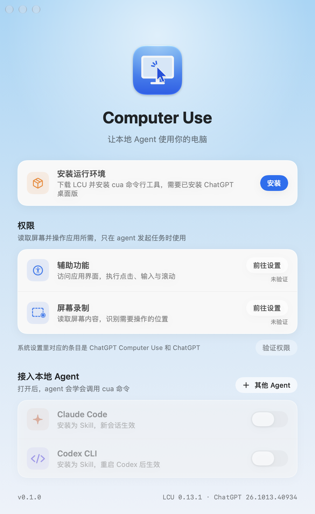

# cua

把 Codex 原版 computer-use 运行时做成一个普通命令行工具。任何能执行 shell 命令的 agent 都能直接用，不需要 MCP，也不需要各家 harness 的适配器。

底层复用 [LCU](https://github.com/amontlabs/lcu) 的 runtime-only 安装（只装运行时，不注册任何 agent）和它的共享客户端；`cua` 自己只做 CLI、后台守护进程和授权弹窗。

## 要求

- macOS，Apple Silicon
- 已安装官方 ChatGPT 桌面版（运行时和 Node 都来自它，cua 不分发任何 OpenAI 文件）

## 设置窗口（Computer Use.app）



- **安装运行环境**：一键下载 LCU 并安装 `cua` 命令行工具（App 内置 CLI 和安装脚本）。
- **权限**：「前往设置」打开对应的系统设置页面；「验证权限」会对访达做一次真实截图。第一次验证时会弹授权框，请选允许。
- **接入本地 Agent**：打开开关后写入 `~/.claude/skills/cua/SKILL.md` 或 `~/.codex/skills/cua/SKILL.md`，关掉就删除（只删本 App 写入的文件）。「其他 Agent」会把通用提示词复制到剪贴板。

构建：

```sh
./build.sh          # 生成 build/CUA.app 和 dist/CUA-<版本>.zip，VERSION=x.y.z 可指定版本
```

本地 `./build.sh` 是临时签名（ad-hoc），别人的电脑第一次打开要右键选「打开」。推送 `v*` tag 后，公开仓库的 Actions 用标准 `macos-15` runner（Apple Silicon，公开仓库不计入分钟数；不要改成 `-large` 或 `-xlarge`）在构建之后做 Developer ID 签名并公证。Release 里的 `CUA-<版本>.zip` 可以直接打开。

## 只装命令行

```sh
./install.sh
```

如果没有 LCU，会先下载 LCU 发布包（校验 SHA-256）并以 `--runtime-only` 安装，然后把 cua 装到 `~/.local/share/cua-cli`，链接到 `~/.local/bin/cua`。

第一次运行时 macOS 会要求给助手程序 Accessibility 和屏幕录制权限。

## 用法

```sh
cua instructions                        # 运行时自带的说明和 API，agent 先读这个
cua js 'await cua.getState()'           # 列出 App / 浏览器
cua js 'let app = await cua.getApp("Notes")'
cua js 'await app.click(12)'            # 变量在多次调用之间保留
cua js -f script.js                     # 从文件读代码；也可以 echo '...' | cua js
cua reset                               # 清空 REPL 状态
cua end-turn                            # 结束本轮（任务结束时调用）
cua apps / cua apps allow Notes         # 管理「始终允许」名单（Touch ID）
cua status | stop
```

- 文本结果输出到 stdout；图片保存到 `~/.local/state/cua-cli/images/`，输出为 `[image: 路径]`。
- 退出码：0 成功，1 运行时报错，2 用法错误或连接失败。
- `--json` 输出原始结果，`--timeout MS` 设置单次执行超时。

## 授权

agent 第一次操作某个 App 时，会弹出 macOS 系统对话框，选项为：允许一次 / 本会话允许 / 始终允许 / 拒绝。只有坐在电脑前的人能回答。点「取消」等于拒绝。调用方进程退出时，挂起的授权会自动取消。

LCU 的保护仍然有效：终端、Claude 和其他 agent 宿主 App 永远不会被授权。

## 会话与轮次

- 守护进程按 `CUA_SESSION` 环境变量（默认 `default`）区分会话。不同 agent 用不同名字，就能互不干扰。
- 一个轮次空闲 5 分钟（`CUA_TURN_IDLE_MIN`）后自动结束，原版运行时随之释放 Computer Use。
- 守护进程空闲 30 分钟（`CUA_EXIT_IDLE_MIN`）后自动退出。日志在 `~/.local/state/cua-cli/daemon.log`。

## 给 agent 的提示词

```text
你可以用 `cua` 命令操作这台 Mac 上的桌面 App。先运行 `cua instructions` 阅读说明，
然后用 `cua js '<代码>'` 执行（变量在多次调用之间保留）。返回的 [image: 路径] 是截图文件。
任务结束后运行 `cua end-turn`。
```
